# DAVE 水下声呐沉船识别

中文 | [Русский](README.ru.md)


本项目整理了 DAVE / BlueROV2 多波束声呐仿真、RViz 可视化、网页虚拟摇杆操作，以及 YOLOv8-seg 声呐沉船实时识别的必要文件。识别节点只订阅声呐图像并发布带标注图像，**不会发布摇杆、MAVROS 或推进器控制指令**。

> **项目阶段：** 第一阶段完成声呐沉船识别验证。演示视频和单帧识别结果见下方。

## 是否需要激活 Python 虚拟环境？

- 启动仿真世界和 RViz：**不需要**激活 YOLO Python 虚拟环境。启动脚本会加载 ROS 2 Jazzy 和 DAVE 工作区。
- 启动 YOLO 实时识别：需要一个能同时导入 ROS Python (`rclpy`、`sensor_msgs`) 和 YOLO/PyTorch 的 Python 环境。你目前已验证可用的 `~/venv-dave-stage1` 可以继续用；运行识别脚本时它会自动激活。不要为了启动世界而激活它。

## 环境前提

此仓库不包含 ROS、Gazebo、DAVE、ArduPilot 或训练数据。先在 WSL Ubuntu 24.04 安装并构建 ROS 2 Jazzy、DAVE 官方工作区及 ArduPilot/Gazebo 插件。启动脚本预期工作区在：

- `~/dave_ws`
- `~/dave_ws_official`
- ArduPilot SITL 在 `~/ardupilot`
- `~/venv-ardupilot`

如果你的工作区路径不同，请先调整 `start_dave_official.sh` 中相应的环境设置。

## 启动世界和 RViz

在 WSL 终端进入克隆后的项目目录：

```bash
bash ./start_dave_and_rviz.sh
```

脚本先启动 DAVE 世界，等潜水器里程计话题出现后再打开 RViz。默认会运行解锁状态守护；若不需要该功能：

```bash
KEEP_ARMED=0 bash ./start_dave_and_rviz.sh
```

停止时在启动终端按 `Ctrl+C`。也可以单独启动世界或 RViz：

```bash
bash ./start_dave_official.sh
bash ./open_dave_rviz.sh
```

## 网页虚拟摇杆

打开 [DAVE Virtual Joystick](https://ioes-lab.github.io/dave/extras/virtual_joystick.html)，确认页面显示 `Connection Connected`。常用操作：

| 操作 | 功能 |
|---|---|
| A | STABILIZE 模式 |
| Y | ALT_HOLD 深度保持模式 |
| MENU | ARM 解锁 |
| VIEW | DISARM 上锁 |
| 左摇杆上下/左右 | 前进后退 / 左右平移 |
| 右摇杆上下/左右 | 上浮下潜 / 左右转向 |
| B / X | 增大 / 减小推力输出 |

## 静态声呐数据采集（Pipe / Box）

仓库附带独立的 [`sonar_collection_static.world`](sonar_collection_static.world)：场景中只有静态海床、箱体、管道和固定多波束声呐，不启动潜水器、ArduSub、MAVROS 或控制器。启动脚本会让声呐朝向所选物体，打开 Gazebo 与 RViz2，并在终端按键采集当前声呐帧。该脚本只读取图像，不会发送推进器指令。

### 依赖与启动

在 WSL Ubuntu 24.04 中，需要已安装 ROS 2 Jazzy、DAVE `dave_demos` / `dave_multibeam_sonar_demo` 包以及多波束声呐系统插件。图像采集 Python 环境还需要 `rclpy`、`sensor_msgs`、NumPy 和 OpenCV；无需 YOLO、PyTorch 或 CUDA。脚本默认查找 `~/dave_ws`、`~/dave_ws_official` 和 `~/dave_ws/install/multibeam_sonar_system`。移植到其他电脑时，请按本机安装位置修改 [`run_static_sonar_collection.sh`](run_static_sonar_collection.sh) 中的 ROS/DAVE source 路径及 `GZ_SIM_SYSTEM_PLUGIN_PATH`；并确保 `dave_multibeam_sonar_demo` 已安装，以提供 RViz 配置。WSL 图形桌面需可用（例如 WSLg）。

```bash
bash ./run_static_sonar_collection.sh
```

启动后选择 `1`（Pipe）或 `2`（Box/Crate）。脚本会自动发现独立声呐实际发布的 `/.../multibeam_sonar/sonar_image` 话题，然后打开 RViz2 和采集界面。按 `S` 保存当前帧，按 `Q` 结束；在启动终端按 `Ctrl+C` 也会结束并关闭场景。图片分别保存在 `sonar_dataset/pipe/` 或 `sonar_dataset/box_crate/`，`sonar_dataset/manifest.csv` 记录类别、话题、编码、尺寸和时间戳。新类别可在 [`collect_sonar_dataset.py`](collect_sonar_dataset.py) 的 `CLASS_CHOICES` 中添加，并在启动脚本中增加对应的声呐位姿分支。

world 使用 Gazebo Fuel 上的 Coast Water、Sand Heightmap 和 Test box 资源；首次运行需要可访问 Fuel。Pipe 是 world 文件中定义的静态圆柱体。第三方资源仍受其各自许可约束。

## YOLO 实时声呐识别

先启动 DAVE 世界并确认声呐图像话题正在发布。使用当前已经装好 YOLO、CUDA 和 ROS Python 依赖的虚拟环境启动（脚本会自动激活 `~/venv-dave-stage1`）：

```bash
bash ./run_sonar_yolo_realtime.sh
```

当前已验证环境：PyTorch `2.6.0+cu124`、CUDA 可用、RTX 4070 Laptop GPU、NumPy `1.26.4`、OpenCV `4.11.0`、Ultralytics `8.4.171`。Windows 上安装 CUDA 并不等于 WSL Python 能使用 CUDA；以脚本打印的 `WSL PyTorch CUDA` 状态为准。不要为这个项目盲目重装 PyTorch。

节点会读取：

```text
/model/bluerov2_heavy_multibeam_sonar/multibeam_sonar/sonar_image
```

并发布：

```text
/dave_yolo/annotated
```

在 RViz 添加 `Image` 显示并选择 `/dave_yolo/annotated`，即可看识别结果。也可以用 ROS 图像查看工具订阅该话题。默认推理上限 2 Hz、输入尺寸 512、置信度阈值 0.47；可覆盖参数，例如：

```bash
bash ./run_sonar_yolo_realtime.sh --rate 1 --imgsz 512 --conf 0.47 --device auto
```

按 `Ctrl+C` 停止。**识别结果目前不控制潜水器。**

## 模型与限制

- 权重：[`models/shipwreck_seg_v1-5_best.pt`](models/shipwreck_seg_v1-5_best.pt)，YOLOv8 分割模型，类别只有 `shipwreck`。未检出沉船不等同于识别出一个明确的“背景类别”。
- 第一阶段权重对应 version 1 训练数据；仓库现已附带 version 2 的完整标注数据集。两者均来自 Roboflow 项目，许可为 CC BY 4.0；见下方署名说明。
- 这是基础实验模型，可能漏检或误检。测试前应在 RViz 中观察真实输出，不要将它视作安全/导航系统。

## 第一阶段成果与声呐识别示例

### 沉船：触发 `Shipwreck` 分割

以下是 YOLO 对沉船声呐图像的识别输出，掩膜和置信度由模型生成。

<table>
  <tr>
    <td align="center">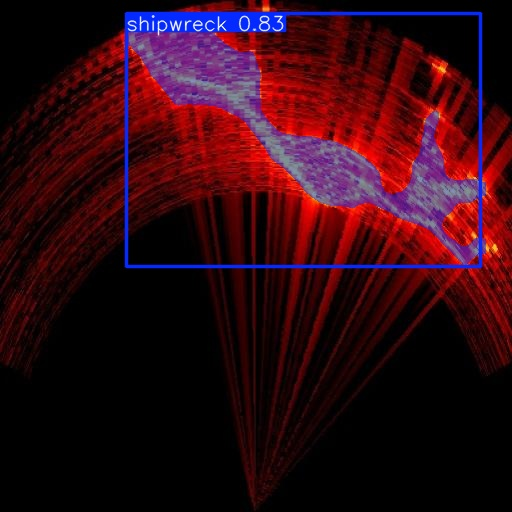<br><sub>样例 1 · 置信度 0.83</sub></td>
    <td align="center">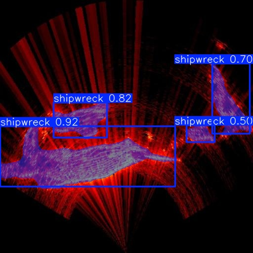<br><sub>样例 2 · 多个区域触发</sub></td>
    <td align="center">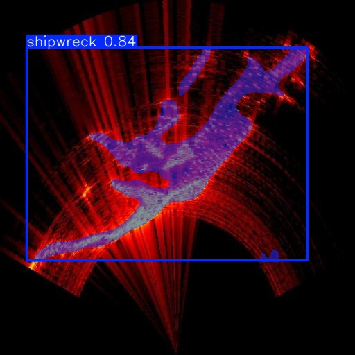<br><sub>样例 3 · 置信度 0.84</sub></td>
  </tr>
</table>

### 沙丘：空标签背景，不触发检测

训练标注中沉船标为 `Shipwreck`，沙丘样本则作为空标签背景。因此这些沙丘声呐帧没有检测框/分割掩膜。这表示模型没有输出已训练类别，并不代表模型单独识别或理解了“沙丘”。

<table>
  <tr>
    <td align="center">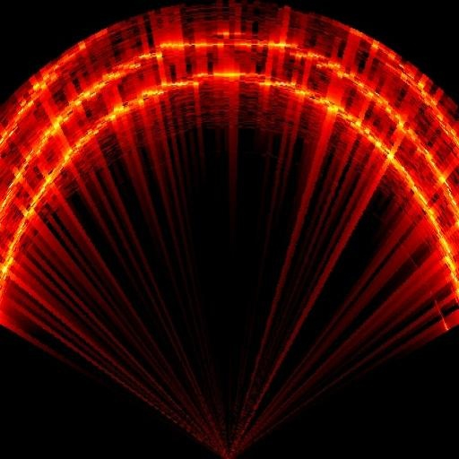<br><sub>沙丘背景 · 无检测输出</sub></td>
    <td align="center">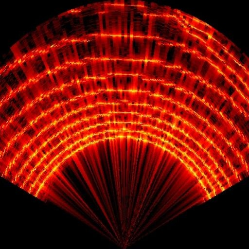<br><sub>沙丘背景 · 无检测输出</sub></td>
    <td align="center">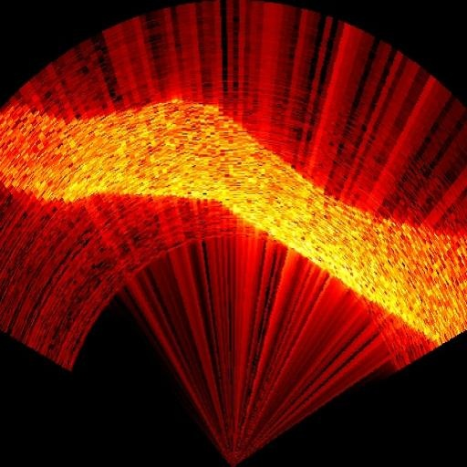<br><sub>沙丘背景 · 无检测输出</sub></td>
  </tr>
</table>

### 演示视频

[`media/test_shipwreck.mp4`](media/test_shipwreck.mp4) 展示了接入 YOLO 后实时识别沉船的过程。

视频通过 Git LFS 存储。克隆仓库后需要安装 Git LFS 并执行 `git lfs pull` 才能取回视频内容；GitHub 的普通 Git 单文件限制为 100 MiB，而该视频约 169.5 MiB。LFS 下载会计入仓库所有者的 Git LFS 带宽额度。

## 第二阶段：动态声呐采集与多类分割数据集

第二阶段将识别范围从沉船扩展到箱体（`box_crate`）和管道（`pipe`）。这些新增物体的声呐图像通过操控潜水器在仿真场景中动态移动、改变观察位置和朝向进行采集；不是用固定在单一位置的声呐头定点采集。图像已完成 YOLOv8 segmentation 多边形标注，并与先前的沉船及空标签背景样本合并。

完整数据集位于 [`datasets/sonar_database-yolov8/`](datasets/sonar_database-yolov8/)，包含 `train`、`valid`、`test` 三个 split 的 images/labels、类别配置和 Roboflow 来源说明。共 **1,119 张图像**（836 train、192 valid、91 test），类别 ID 与名称为：`0: box_crate`、`1: pipe`、`2: shipwreck`。按包含类别的图像计数：box_crate 270 张、pipe 295 张、shipwreck 462 张；另有 92 张空标签背景图。背景是空标签，不是一个额外类别。数据集约 45.7 MB，随仓库直接提供。

### 管道与箱体声呐图示例

以下各展示 3 张验证集中的原始声呐图像。对应的 YOLOv8 segmentation 多边形标注保存在同名 `valid/labels/*.txt` 文件中；图片本身未叠加或伪造标注轮廓。

<table>
  <tr>
    <th colspan="3">Pipe（水下管道）</th>
  </tr>
  <tr>
    <td align="center">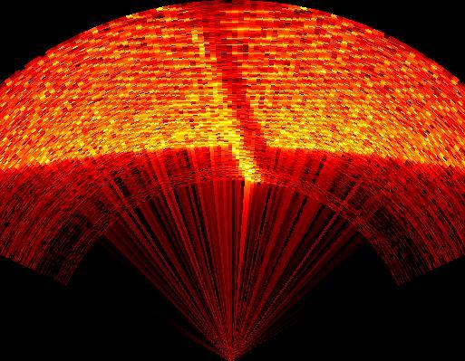<br><sub>Pipe · 1</sub></td>
    <td align="center">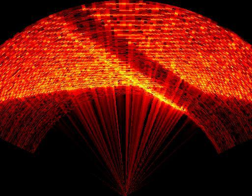<br><sub>Pipe · 2</sub></td>
    <td align="center">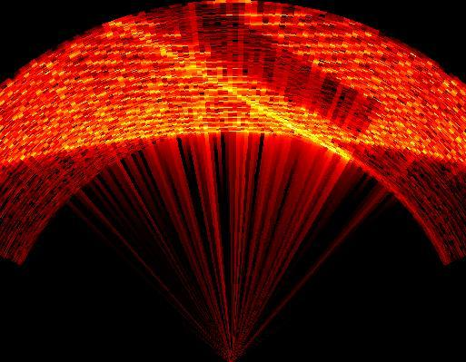<br><sub>Pipe · 3</sub></td>
  </tr>
  <tr>
    <th colspan="3">Box / Crate（箱体）</th>
  </tr>
  <tr>
    <td align="center">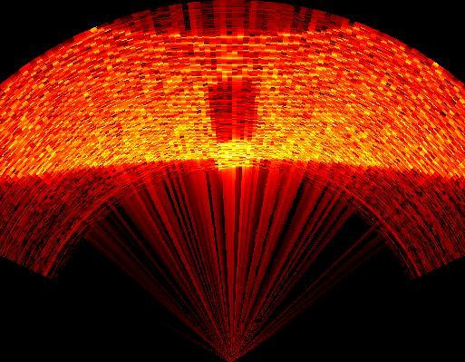<br><sub>Box/Crate · 1</sub></td>
    <td align="center">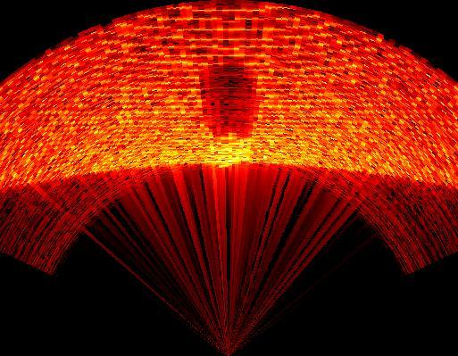<br><sub>Box/Crate · 2</sub></td>
    <td align="center">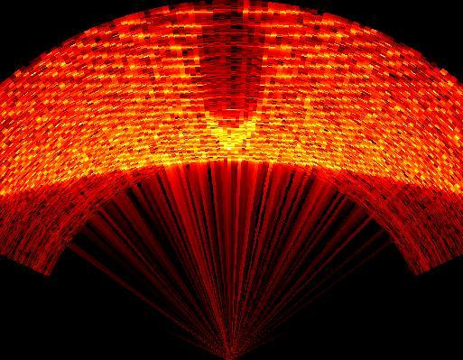<br><sub>Box/Crate · 3</sub></td>
  </tr>
</table>

`data.yaml` 的路径已调整为相对该目录的 `train/images`、`valid/images`、`test/images`，以便在克隆后的仓库中直接定位。若将数据集单独移动到其他目录，请据此更新 `data.yaml` 中的路径。

此数据集由 Roboflow Universe 的 **My First Project**, `nothingbeatyous-workspace`, version 2 导出，许可为 CC BY 4.0：[version 2 数据集页面](https://universe.roboflow.com/nothingbeatyous-workspace/my-first-project-4vdi4/dataset/2)。再分发时请保留数据集内的来源说明，并遵守 CC BY 4.0 署名要求。包含分割标签不代表这些标签或模型已通过独立质量审查。

## 第二阶段模型与训练结果

新版三类分割权重单独作为 [`models/sonar_seg_v2_best.pt`](models/sonar_seg_v2_best.pt) 提供；原有沉船模型未覆盖。完整训练交付物（权重副本、参数、曲线、混淆矩阵、测试集预测图、推理脚本与评估视频）位于 [`training/sonar_seg_v2_results/`](training/sonar_seg_v2_results/)。训练摘要见[指标说明](training/sonar_seg_v2_results/00_指标汇总.md)，完整参数见 [`args.yaml`](training/sonar_seg_v2_results/args.yaml)。

### 测试集表现

模型为预训练 `yolov8n-seg`，输入尺寸 512；训练在 RTX 4060 Laptop 上进行，best checkpoint 为 epoch 84（训练于 epoch 194 早停）。在 91 张测试图像、109 个实例上，整体 Box mAP50 为 **0.865**，Mask mAP50 为 **0.877**；Mask mAP50–95 为 **0.472**。权重已在本项目 RTX 4070 环境重新加载，并复跑同一测试集，整体指标与随附结果一致。以下是分类别结果：

| 类别 | 实例 | Box mAP50 | Mask mAP50 | Mask mAP50–95 |
|---|---:|---:|---:|---:|
| box_crate | 27 | 0.995 | 0.995 | 0.682 |
| pipe | 29 | 0.995 | 0.995 | 0.493 |
| shipwreck | 53 | 0.606 | 0.642 | 0.241 |

箱体和管道在这份测试集上分数很高；沉船仍是主要短板。测试集规模较小，尤其需要扩大背景与不同场景的独立测试，不能仅凭这些分数推断真实环境泛化能力。

### 混淆矩阵与训练曲线

下方混淆矩阵横轴是真实类别，纵轴是模型预测类别；`background` 是未匹配到目标的背景项，不是训练中的第四个类别。归一化矩阵按真实类别列归一化。固定置信度/IoU 下的混淆矩阵用于观察当前阈值的错分与背景误报；mAP 则在多个置信度阈值上汇总，因此不应要求矩阵计数与表格中的 P/R 完全换算一致。

在测试矩阵中，箱体和管道的目标实例都落在各自的正确类别；沉船仍有漏检。更显眼的问题是背景列出现了不少前景预测，且大多被判为沉船：当前 6 张纯背景测试图不足以证明背景误报已解决，需要补充更多多样化的空标签声呐图，并单独观察误报。

<table>
  <tr>
    <td align="center">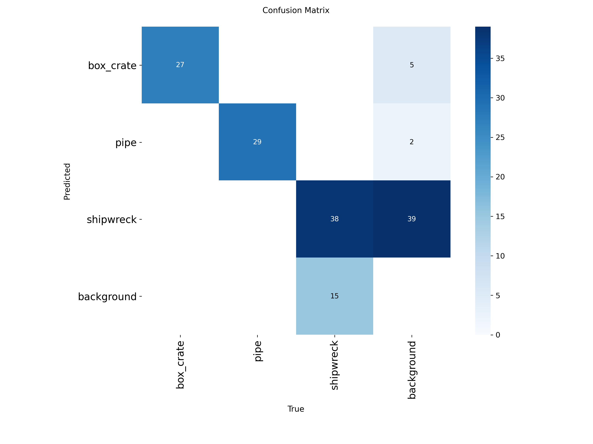<br><sub>测试集混淆矩阵（实例计数）</sub></td>
    <td align="center">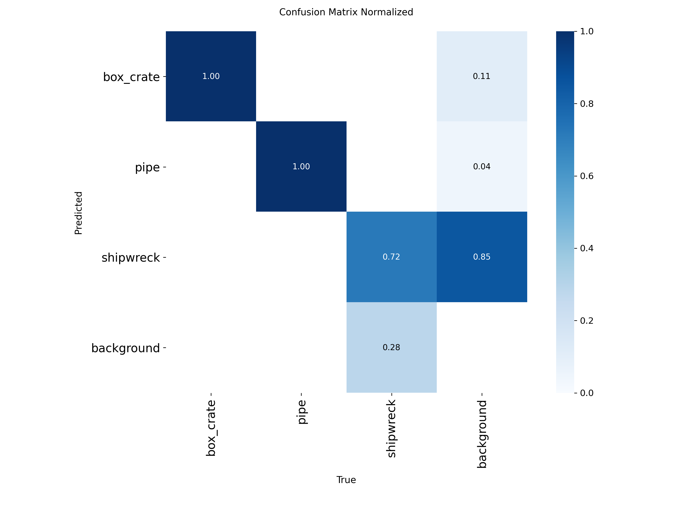<br><sub>按真实类别归一化</sub></td>
  </tr>
</table>

分类别 mAP 图显示箱体/管道较强而沉船明显偏低。训练曲线中训练损失持续下降，但验证集 box、seg 与 dfl 损失在约 epoch 80–100 后总体回升，提示继续训练可能过拟合；选择 epoch 84 的 best checkpoint 是合理的。曲线中的小幅波动也说明这些测试结果仍有抽样不确定性。

<table>
  <tr>
    <td align="center">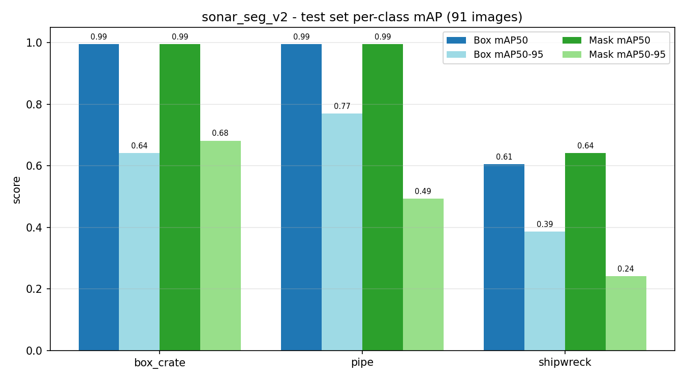<br><sub>测试集分类别 Box/Mask mAP</sub></td>
    <td align="center">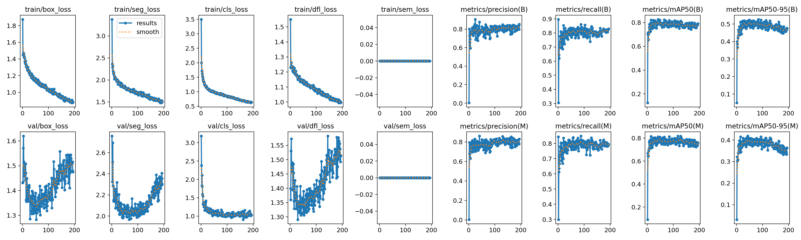<br><sub>194 个 epoch 的训练与验证曲线</sub></td>
  </tr>
</table>

完整数据集推理视频 [sonar_seg_v2_dataset_review.mp4](training/sonar_seg_v2_results/sonar_seg_v2_dataset_review.mp4) 遍历了 1,119 张图像；按最高置信度预测类别随机排列，同一类别每段最多 20 帧，并包含背景/未检出段。统计与分段顺序见 [`sonar_seg_v2_dataset_review.json`](training/sonar_seg_v2_results/sonar_seg_v2_dataset_review.json)。背景/未检出是模型没有输出目标的结果，其中既有真实背景，也可能包含漏检。

## 数据与第三方内容署名

第一阶段模型基于 **My First Project** version 1 训练（Roboflow Universe，CC BY 4.0）：[version 1 数据集页面](https://universe.roboflow.com/nothingbeatyous-workspace/my-first-project-4vdi4/dataset/1)。第二阶段合并后的标注数据集为 version 2，已随仓库发布，见上方链接。依 CC BY 4.0 要求保留署名、许可链接并说明修改/衍生；若再分发数据或模型，请同时提供本说明。

场景文件引用了 DAVE / Fuel 的第三方仿真资源；请同时遵守各资源原始仓库与模型文件中的许可。DAVE、ROS 2、Gazebo、ArduPilot、Ultralytics 及 PyTorch 均为各自项目所有，本仓库不重新许可这些第三方软件。项目自有代码的独立许可尚未指定。

## 内容范围

仓库包含运行脚本、世界/RViz 配置、实时识别代码、阶段模型权重、阶段性演示视频、第二阶段完整 YOLOv8 segmentation 数据集和新版模型训练结果。虚拟环境、RL 检查点和用户机器上的绝对路径配置不包含在内。
