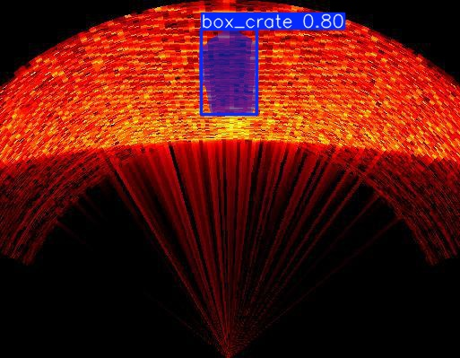
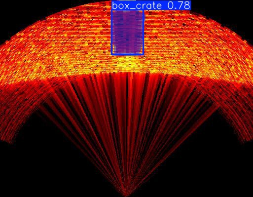
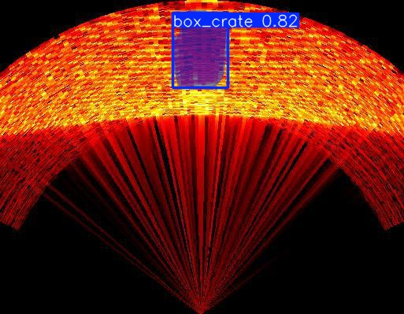
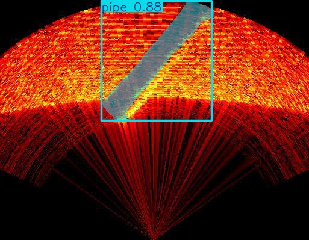
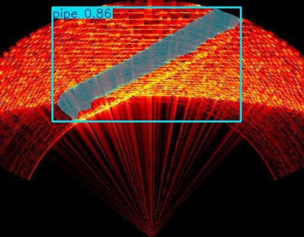
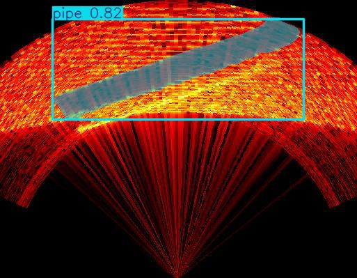

# Обнаружение затонувших судов по сонару в DAVE

[中文](README.md) | Русский


В репозитории собраны необходимые файлы для симуляции многолучевого сонара DAVE / BlueROV2, визуализации в RViz, управления через веб-джойстик и потокового обнаружения затонувших судов моделью YOLOv8-seg. Узел распознавания только получает изображения сонара и публикует кадры с аннотациями. **Он не отправляет команды джойстику, MAVROS или движителям.**

> **Этап проекта:** на первом этапе проверено обнаружение затонувшего судна по сонарным изображениям. Видео и отдельные примеры показаны ниже.

## Нужна ли активация виртуального окружения Python?

- Для запуска мира и RViz: **нет**, окружение Python для YOLO не требуется. Скрипты подключают ROS 2 Jazzy и рабочие пространства DAVE.
- Для распознавания YOLO: нужно окружение Python, в котором доступны ROS-модули (`rclpy`, `sensor_msgs`) и YOLO/PyTorch. Уже проверенное окружение `~/venv-dave-stage1` можно продолжать использовать; скрипт распознавания активирует его автоматически. Для запуска мира активировать его не нужно.

## Требования

ROS, Gazebo, DAVE, ArduPilot и обучающие данные в репозитории не поставляются. Сначала установите и соберите в WSL Ubuntu 24.04 ROS 2 Jazzy, официальные рабочие пространства DAVE и плагины ArduPilot/Gazebo. Скрипты ожидают следующие пути:

- `~/dave_ws`
- `~/dave_ws_official`
- ArduPilot SITL: `~/ardupilot`
- `~/venv-ardupilot`

Если рабочие пространства находятся в других каталогах, настройте соответствующие пути в `start_dave_official.sh`.

## Запуск мира и RViz

В терминале WSL перейдите в каталог клонированного проекта и выполните:

```bash
bash ./start_dave_and_rviz.sh
```

Скрипт запускает мир DAVE, ждёт появления топика одометрии аппарата и затем открывает RViz. По умолчанию включён сторожевой процесс, поддерживающий состояние ARM. Чтобы отключить его:

```bash
KEEP_ARMED=0 bash ./start_dave_and_rviz.sh
```

Для остановки нажмите `Ctrl+C` в терминале запуска. Мир и RViz можно запускать отдельно:

```bash
bash ./start_dave_official.sh
bash ./open_dave_rviz.sh
```

## Веб-джойстик

Откройте [DAVE Virtual Joystick](https://ioes-lab.github.io/dave/extras/virtual_joystick.html) и убедитесь, что отображается `Connection Connected`.

| Управление | Действие |
|---|---|
| A | Режим STABILIZE |
| Y | Режим ALT_HOLD, удержание глубины |
| MENU | ARM, разблокировать движители |
| VIEW | DISARM, заблокировать движители |
| Левый стик вверх/вниз и влево/вправо | Вперёд/назад и боковое перемещение |
| Правый стик вверх/вниз и влево/вправо | Всплытие/погружение и поворот |
| B / X | Увеличить / уменьшить тягу |

## Сбор статичных сонарных данных (Pipe / Box)

В репозитории есть отдельный мир [`sonar_collection_static.world`](sonar_collection_static.world): статичное морское дно, ящик, труба и неподвижный многолучевой сонар. Аппарат, ArduSub, MAVROS и контроллеры не запускаются. Скрипт направляет сонар на выбранный объект, открывает Gazebo и RViz2 и сохраняет текущий кадр по нажатию клавиши. Скрипт только читает изображения и не отправляет команды движителям.

### Зависимости и запуск

В WSL Ubuntu 24.04 должны быть установлены ROS 2 Jazzy, пакеты DAVE `dave_demos` / `dave_multibeam_sonar_demo` и системный плагин многолучевого сонара. Для Python-сбора нужны `rclpy`, `sensor_msgs`, NumPy и OpenCV; YOLO, PyTorch и CUDA не требуются. По умолчанию скрипт ищет `~/dave_ws`, `~/dave_ws_official` и плагин в `~/dave_ws/install/multibeam_sonar_system`. При переносе на другой компьютер измените в [`run_static_sonar_collection.sh`](run_static_sonar_collection.sh) пути подключения ROS/DAVE и `GZ_SIM_SYSTEM_PLUGIN_PATH` в соответствии с локальной установкой. Пакет `dave_multibeam_sonar_demo` нужен для RViz-конфигурации. Также должен работать графический интерфейс WSL (например, WSLg).

```bash
bash ./run_static_sonar_collection.sh
```

Выберите `1` (Pipe) или `2` (Box/Crate). Скрипт автоматически находит фактический топик `/.../multibeam_sonar/sonar_image`, затем открывает RViz2 и интерфейс сбора. Нажмите `S`, чтобы сохранить текущий кадр, или `Q`, чтобы завершить сбор; `Ctrl+C` в исходном терминале также завершает работу и закрывает сцену. Изображения сохраняются в `sonar_dataset/pipe/` или `sonar_dataset/box_crate/`, а `sonar_dataset/manifest.csv` содержит класс, топик, кодировку, размеры и временную метку. Чтобы добавить класс, измените `CLASS_CHOICES` в [`collect_sonar_dataset.py`](collect_sonar_dataset.py) и добавьте соответствующую ветку положения сонара в скрипт запуска.

Мир использует ресурсы Coast Water, Sand Heightmap и Test box из Gazebo Fuel; при первом запуске нужен доступ к Fuel. Pipe определён непосредственно в world как статичный цилиндр. На сторонние ресурсы распространяются их собственные лицензии.

## Потоковое распознавание сонарных изображений YOLO

Сначала запустите DAVE и убедитесь, что публикуется топик изображения сонара. Затем используйте уже настроенное окружение с YOLO, CUDA и ROS Python-модулями (скрипт автоматически активирует `~/venv-dave-stage1`):

```bash
bash ./run_sonar_yolo_realtime.sh
```

Проверенная конфигурация: PyTorch `2.6.0+cu124`, CUDA доступна, RTX 4070 Laptop GPU, NumPy `1.26.4`, OpenCV `4.11.0`, Ultralytics `8.4.171`. Установка CUDA в Windows сама по себе не означает, что CUDA доступна Python внутри WSL. Ориентируйтесь на строку `WSL PyTorch CUDA` в выводе скрипта. Не переустанавливайте PyTorch без необходимости.

Входной топик:

```text
/model/bluerov2_heavy_multibeam_sonar/multibeam_sonar/sonar_image
```

Выходной топик с аннотациями:

```text
/dave_yolo/annotated
```

В RViz добавьте отображение `Image` и выберите `/dave_yolo/annotated`. Можно также открыть топик любым ROS-инструментом просмотра изображений. По умолчанию ограничение частоты инференса — 2 Гц, размер — 512, порог уверенности — 0.47. Параметры можно изменить:

```bash
bash ./run_sonar_yolo_realtime.sh --rate 1 --imgsz 512 --conf 0.47 --device auto
```

Для остановки нажмите `Ctrl+C`. **Результаты распознавания пока не управляют аппаратом.**

## Модель и ограничения

- Веса: [`models/shipwreck_seg_v1-5_best.pt`](models/shipwreck_seg_v1-5_best.pt). Это модель сегментации YOLOv8 с единственным классом `shipwreck`. Отсутствие обнаружения не является отдельным явным классом «фон».
- Веса первой стадии соответствуют обучающему набору version 1; полный размеченный набор version 2 теперь включён в репозиторий. Оба набора получены из проекта Roboflow и распространяются по CC BY 4.0; атрибуция приведена ниже.
- Это базовая экспериментальная модель; возможны пропуски и ложные срабатывания. Проверяйте результаты в RViz и не используйте модель как систему безопасности или навигации.

## Результаты первого этапа и примеры сонарных изображений

### Затонувшее судно: срабатывание сегментации `Shipwreck`

Ниже показаны результаты YOLO для сонарных изображений судна: маски и значения уверенности построены моделью.

<table>
  <tr>
    <td align="center"><br><sub>Пример 1 · уверенность 0,83</sub></td>
    <td align="center"><br><sub>Пример 2 · несколько срабатываний</sub></td>
    <td align="center"><br><sub>Пример 3 · уверенность 0,84</sub></td>
  </tr>
</table>

### Дюны: фон с пустыми метками, обнаружение не срабатывает

При обучении судно размечено классом `Shipwreck`, а примеры дюн используются как фон с пустыми метками. Поэтому на этих сонарных кадрах нет рамок или масок. Это означает, что модель не выдала обученный класс, а не то, что она отдельно распознала или поняла семантику «дюна».

<table>
  <tr>
    <td align="center"><br><sub>Фон — дюна · нет срабатывания</sub></td>
    <td align="center"><br><sub>Фон — дюна · нет срабатывания</sub></td>
    <td align="center"><br><sub>Фон — дюна · нет срабатывания</sub></td>
  </tr>
</table>

### Видео демонстрации

В [`media/test_shipwreck.mp4`](media/test_shipwreck.mp4) показан процесс успешного обнаружения затонувшего судна YOLO в реальном времени.

Видео хранится через Git LFS. Чтобы получить его после клонирования, установите Git LFS и выполните `git lfs pull`. Обычный лимит GitHub для одного файла Git — 100 МиБ, а размер этого видео около 169,5 МиБ. Загрузка через LFS расходует квоту трафика Git LFS владельца репозитория.

## Второй этап: динамический сбор сонарных данных и многоклассовая сегментация

На втором этапе распознавание расширено с затонувших судов на ящики (`box_crate`) и трубы (`pipe`). Новые сонарные изображения этих объектов собирались при ручном управлении аппаратом: ROV динамически перемещался в симуляции, меняя положение наблюдения и направление. Это не сбор неподвижным сонаром из одной фиксированной точки. Изображения размечены полигонами в формате YOLOv8 segmentation и объединены с прежними примерами судов и фоновыми кадрами с пустыми метками.

Полный набор находится в [`datasets/sonar_database-yolov8/`](datasets/sonar_database-yolov8/) и включает splits `train`, `valid`, `test`, каталоги images/labels, конфигурацию классов и сведения об источнике Roboflow. Всего **1 119 изображений** (836 train, 192 valid, 91 test). Идентификаторы классов: `0: box_crate`, `1: pipe`, `2: shipwreck`. По числу изображений, содержащих класс: box_crate — 270, pipe — 295, shipwreck — 462; дополнительно есть 92 фоновых изображения с пустыми метками. Фон не является отдельным классом. Размер набора около 45,7 МБ; он включён в репозиторий напрямую.

### Примеры сонарных изображений труб и ящиков

Ниже представлены по три исходных сонарных кадра из валидационной выборки для каждого объекта. Соответствующие полигоны YOLOv8 segmentation находятся в одноимённых файлах `valid/labels/*.txt`; контуры разметки не накладывались на эти изображения.

<table>
  <tr>
    <th colspan="3">Pipe (подводная труба)</th>
  </tr>
  <tr>
    <td align="center"><br><sub>Pipe · 1</sub></td>
    <td align="center"><br><sub>Pipe · 2</sub></td>
    <td align="center"><br><sub>Pipe · 3</sub></td>
  </tr>
  <tr>
    <th colspan="3">Box / Crate (ящик)</th>
  </tr>
  <tr>
    <td align="center"><br><sub>Box/Crate · 1</sub></td>
    <td align="center"><br><sub>Box/Crate · 2</sub></td>
    <td align="center"><br><sub>Box/Crate · 3</sub></td>
  </tr>
</table>

### Примеры сегментации новой моделью

Ниже показаны реальные предсказания `sonar_seg_v2_best.pt` на сонарных изображениях тестовой выборки: цветная область — предсказанная моделью маска, рамка и подпись показывают класс и confidence. Это несколько иллюстративных примеров; они не заменяют полные метрики и не гарантируют такое же качество на каждом кадре.

<table>
  <tr>
    <th colspan="3">Box / Crate (предсказания сегментации)</th>
  </tr>
  <tr>
    <td align="center"><br><sub>Box/Crate · conf 0,80</sub></td>
    <td align="center"><br><sub>Box/Crate · conf 0,78</sub></td>
    <td align="center"><br><sub>Box/Crate · conf 0,82</sub></td>
  </tr>
  <tr>
    <th colspan="3">Pipe (предсказания сегментации трубы)</th>
  </tr>
  <tr>
    <td align="center"><br><sub>Pipe · conf 0,88</sub></td>
    <td align="center"><br><sub>Pipe · conf 0,86</sub></td>
    <td align="center"><br><sub>Pipe · conf 0,82</sub></td>
  </tr>
</table>

Пути в `data.yaml` настроены относительно этой директории: `train/images`, `valid/images`, `test/images`. Если переместить набор отдельно после клонирования, обновите соответствующие пути.

Набор экспортирован из **My First Project**, `nothingbeatyous-workspace`, version 2 на Roboflow Universe под лицензией CC BY 4.0: [страница набора version 2](https://universe.roboflow.com/nothingbeatyous-workspace/my-first-project-4vdi4/dataset/2). При повторном распространении сохраните сведения об источнике и соблюдайте требования атрибуции CC BY 4.0. Наличие полигональных меток не означает, что их качество прошло независимую проверку.

## Модель второго этапа и результаты обучения

Новые веса сегментации трёх классов опубликованы отдельно: [`models/sonar_seg_v2_best.pt`](models/sonar_seg_v2_best.pt); исходная модель обнаружения затонувших судов не заменена. Полный комплект результатов (копия весов, параметры, графики, матрицы ошибок, визуализации тестовых предсказаний, скрипт инференса и видеообзор) находится в [`training/sonar_seg_v2_results/`](training/sonar_seg_v2_results/). Сводка приведена в [описании метрик](training/sonar_seg_v2_results/00_指标汇总.md), параметры — в [`args.yaml`](training/sonar_seg_v2_results/args.yaml).

### Результаты на тестовой выборке

Использовалась предобученная `yolov8n-seg` с размером входа 512. Обучение проходило на RTX 4060 Laptop; лучший checkpoint — epoch 84, ранняя остановка произошла на epoch 194. На тестовой выборке из 91 изображения и 109 экземпляров Box mAP50 составил **0,865**, Mask mAP50 — **0,877**, Mask mAP50–95 — **0,472**. Веса были повторно загружены и проверены на той же тестовой выборке на RTX 4070 в этом проекте; общие метрики совпали с приложёнными результатами.

| Класс | Экземпляры | Box mAP50 | Mask mAP50 | Mask mAP50–95 |
|---|---:|---:|---:|---:|
| box_crate | 27 | 0,995 | 0,995 | 0,682 |
| pipe | 29 | 0,995 | 0,995 | 0,493 |
| shipwreck | 53 | 0,606 | 0,642 | 0,241 |

На этой тестовой выборке ящики и трубы показывают высокие значения, а затонувшее судно остаётся основным слабым классом. Выборка невелика; особенно важно расширить независимую проверку фоновыми изображениями и новыми сценами. Эти метрики сами по себе не доказывают обобщение на реальные условия.

### Матрицы ошибок и графики обучения

По горизонтали на матрицах указаны истинные классы, по вертикали — предсказанные. `background` — фон/несопоставленные объекты, а не четвёртый обучаемый класс. Нормированная матрица вычислена по столбцам истинных классов. Матрица ошибок показывает ошибки при фиксированных порогах confidence/IoU; mAP агрегируется по нескольким порогам confidence, поэтому численные значения матрицы нельзя напрямую пересчитать в табличные P/R.

В тестовой матрице экземпляры ящиков и труб отнесены к своим классам; у затонувшего судна остаются пропуски. Отдельно заметны ложные срабатывания на фоне, преимущественно как `shipwreck`. В тесте всего 6 чистых фоновых изображений — этого недостаточно, чтобы считать проблему фоновых ложных тревог решённой; нужны дополнительные разнообразные сонарные кадры без объектов и отдельный анализ ошибок.

<table>
  <tr>
    <td align="center"><br><sub>Матрица ошибок теста (количество экземпляров)</sub></td>
    <td align="center"><br><sub>Нормировка по истинному классу</sub></td>
  </tr>
</table>

График mAP по классам показывает преимущество ящиков и труб и заметно более слабое качество для затонувшего судна. На кривых обучения train-loss продолжает снижаться, тогда как box-, seg- и dfl-loss на валидации в целом растут после примерно epoch 80–100. Это указывает на возможное переобучение при продолжении обучения; выбор лучшего checkpoint на epoch 84 выглядит обоснованным. Колебания метрик также напоминают о неопределённости небольшой выборки.

<table>
  <tr>
    <td align="center"><br><sub>Box/Mask mAP по классам</sub></td>
    <td align="center"><br><sub>Кривые обучения и валидации за 194 epoch</sub></td>
  </tr>
</table>

Видео инференса по всему набору [sonar_seg_v2_dataset_review.mp4](training/sonar_seg_v2_results/sonar_seg_v2_dataset_review.mp4) включает все 1 119 изображений. Кадры случайно упорядочены по классу с максимальной уверенностью; в каждом непрерывном блоке не более 20 кадров одного класса. Также включён блок фона/отсутствия детекции. Статистика и порядок блоков находятся в [`sonar_seg_v2_dataset_review.json`](training/sonar_seg_v2_results/sonar_seg_v2_dataset_review.json). Отсутствие детекции включает как настоящие фоновые кадры, так и возможные пропуски.

## Атрибуция данных и сторонних материалов

Модель первого этапа обучена на **My First Project**, version 1 (Roboflow Universe, CC BY 4.0): [страница набора version 1](https://universe.roboflow.com/nothingbeatyous-workspace/my-first-project-4vdi4/dataset/1). Объединённый размеченный набор второго этапа — version 2; он включён в репозиторий, ссылка приведена выше. Лицензия CC BY 4.0 требует сохранять атрибуцию, ссылку на лицензию и указывать изменения/производные материалы; при распространении данных или модели приложите эту информацию.

Файлы сцены ссылаются на сторонние ресурсы симуляции DAVE / Fuel. Соблюдайте лицензии исходных репозиториев и файлов моделей. DAVE, ROS 2, Gazebo, ArduPilot, Ultralytics и PyTorch принадлежат соответствующим проектам; этот репозиторий не переиздаёт их лицензии. Отдельная лицензия для собственного кода проекта пока не указана.

## Состав репозитория

В репозитории находятся скрипты запуска, файлы мира и RViz, код потокового распознавания, веса моделей разных этапов, демонстрационные видео, полный набор данных YOLOv8 segmentation второго этапа и результаты обучения новой модели. Виртуальные окружения, контрольные точки RL и абсолютные пути локального компьютера не включены.
